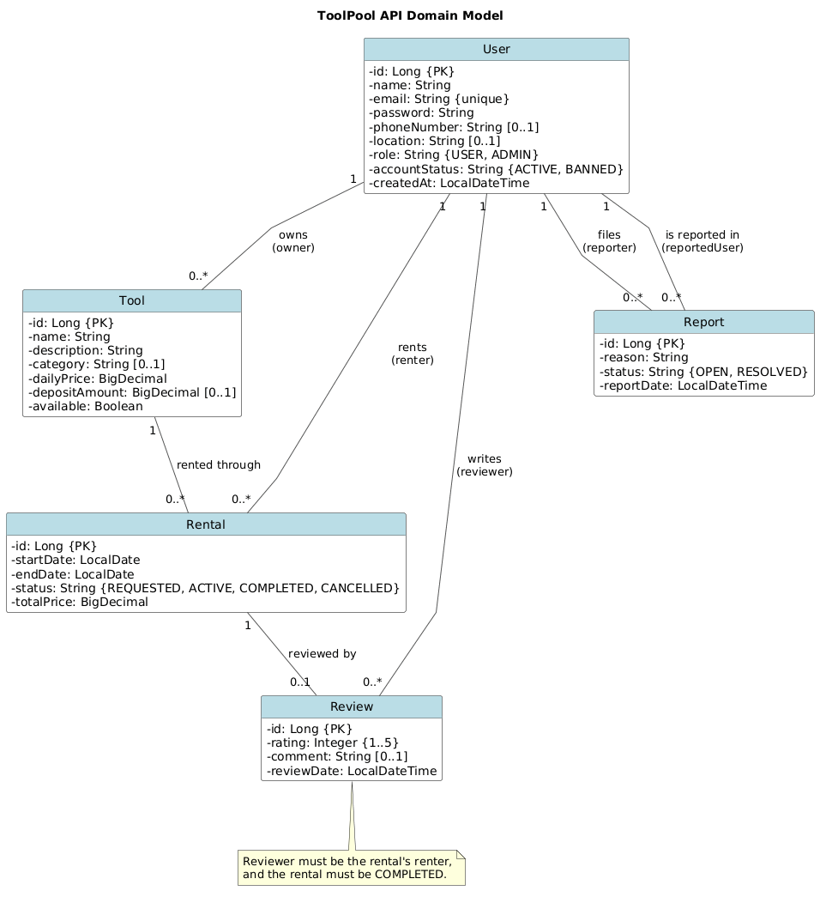

# ToolPool Backend API

Spring Boot + PostgreSQL (Neon) REST API for ToolPool, a peer-to-peer tool rental platform.

**Team:** Christopher Roan ([@CRoan3](https://github.com/CRoan3)), Nobert Akas ([@mtunelife](https://github.com/mtunelife))

# UML Class Diagram



Editable source: [`docs/uml-class.puml`](../docs/uml-class.puml)

# API Overview

**Base URL:**

- local: http://localhost:8080/api

JSON request bodies are validated. Errors return a JSON body with a message:

```json
{ "error": "An account with that email already exists." }
```

| Code              | Meaning                                                              |
| ----------------- | -------------------------------------------------------------------- |
| `400 Bad Request` | Invalid input (missing/blank required field, bad email, etc.)        |
| `404 Not Found`   | The id in the path does not exist                                    |
| `409 Conflict`    | Duplicate record (e.g. email already in use) or invalid state change |

Objects are linked by id in request bodies (for example `"ownerId": 1`), not by nested objects.

## Users

| Method | Path         | Purpose           | Response code | Error codes | User story                                         | Implemented by   |
| ------ | ------------ | ----------------- | ------------- | ----------- | -------------------------------------------------- | ---------------- |
| `POST` | `/api/users` | Create an account | `201 Created` | `400, 409`  | [US-1](../docs/Requirements%20-%20ToolPool.md#L55) | Christopher Roan |

New users are always created with `role` = `USER` and `accountStatus` = `ACTIVE`; these fields
cannot be set in the request. Passwords are accepted on registration and never included in responses.

### Example: Create a user

```http
POST /api/users
Content-Type: application/json

{
  "name": "Chris Roan",
  "email": "chris@example.com",
  "password": "secret123",
  "phoneNumber": "336-555-0101",
  "location": "Greensboro, NC"
}
```

| Field         | Required | Rules                                                      |
| ------------- | -------- | ---------------------------------------------------------- |
| `name`        | yes      | not blank, max 100 characters                              |
| `email`       | yes      | valid email, max 254 characters, unique (case-insensitive) |
| `password`    | yes      | 8–72 characters                                            |
| `phoneNumber` | no       | max 20 characters                                          |
| `location`    | no       | max 100 characters                                         |

Response `201 Created` (with header `Location: /api/users/1`):

```json
{
  "id": 1,
  "name": "Chris Roan",
  "email": "chris@example.com",
  "phoneNumber": "336-555-0101",
  "location": "Greensboro, NC",
  "role": "USER",
  "accountStatus": "ACTIVE",
  "createdAt": "2026-10-18T15:18:02.815116"
}
```

# Running Locally

Requires JDK 25. Set your **Neon dev branch** connection string in the same terminal you run the app from
(never commit it):

```powershell
$env:SPRING_DATASOURCE_URL="jdbc:postgresql://..."
.\mvnw.cmd spring-boot:run
```
