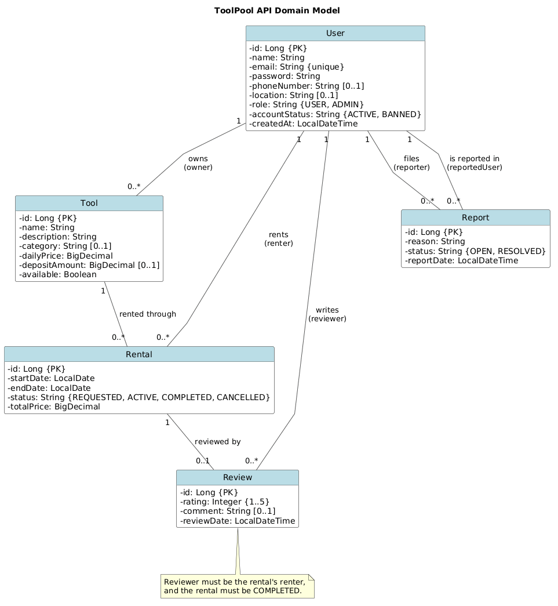

# ToolPool Backend API

Spring Boot + PostgreSQL (Neon) REST API for ToolPool, a peer-to-peer tool rental platform, plus
the web pages that use it (see [Web Pages](#web-pages-frontend)). Run the app and open
http://localhost:8080 to use the site.

**Team:** Christopher Roan ([@CRoan3](https://github.com/CRoan3)), Nobert Akas ([@mtunelife](https://github.com/mtunelife))

# UML Class Diagram



Editable source: [`docs/uml-class.puml`](../docs/uml-class.puml)

# API Overview

**Base URL:**

- local: http://localhost:8080/api
- production: [https://toolpool-csc340-team16-konz.onrender.com/api/](https://toolpool-csc340-team16-konz.onrender.com/api/)

> **Cold start:** the production API runs on Render's free tier, which sleeps after about 15 minutes
> of inactivity. The first request after that can take up to a minute while it wakes up. Neon also
> scales idle databases to zero, which adds a short delay to the first query.

JSON request bodies are validated. Errors return a JSON body with a message:

```json
{ "error": "An account with that email already exists." }
```

| Code              | Meaning                                                              |
| ----------------- | -------------------------------------------------------------------- |
| `400 Bad Request` | Invalid input (missing/blank required field, bad email, etc.)        |
| `401 Unauthorized`| Wrong email or password when logging in                              |
| `403 Forbidden`   | The action isn't allowed (e.g. a banned account logging in)          |
| `404 Not Found`   | The id in the path does not exist                                    |
| `409 Conflict`    | Duplicate record (e.g. email already in use) or invalid state change |

Objects are linked by id in request bodies (for example `"ownerId": 1`), not by nested objects.

Authentication is not implemented yet: ids in paths and request bodies (such as `ownerId` or
`reviewerId`) are not proof of identity.

## Users

| Method | Path              | Purpose                                              | Response code | Error codes     | User story                                             | Implemented by   |
| ------ | ----------------- | ---------------------------------------------------- | ------------- | --------------- | ------------------------------------------------------ | ---------------- |
| `POST` | `/api/users`      | Create an account                                    | `201 Created` | `400, 409`      | [US-1](../docs/Requirements%20-%20ToolPool.md#L55)     | Christopher Roan |
| `POST` | `/api/users/login` | Log in with email and password                      | `200 OK`      | `400, 401, 403` | [US-1](../docs/Requirements%20-%20ToolPool.md#L55)     | Christopher Roan |
| `GET`  | `/api/users/{id}` | View a user's profile                                | `200 OK`      | `404`           | [Story 7](../docs/Requirements%20-%20ToolPool.md#L111) | Christopher Roan |
| `PUT`  | `/api/users/{id}` | Edit a user's profile (name, email, phone, location) | `200 OK`      | `400, 404, 409` | [Story 7](../docs/Requirements%20-%20ToolPool.md#L111) | Christopher Roan |
| `GET`    | `/api/users`             | Admin: list all users (optional `?accountStatus=ACTIVE` or `BANNED`) | `200 OK`         | `400`           | [Story 1](../docs/Requirements%20-%20ToolPool.md#L99) | Christopher Roan |
| `PUT`    | `/api/users/{id}/status` | Admin: ban or unban a user                                           | `200 OK`         | `400, 404`      | [Story 1](../docs/Requirements%20-%20ToolPool.md#L99) | Christopher Roan |
| `DELETE` | `/api/users/{id}`        | Admin: permanently remove a user                                     | `204 No Content` | `404, 409`      | [Story 1](../docs/Requirements%20-%20ToolPool.md#L99) | Christopher Roan |

New users are always created with `role` = `USER` and `accountStatus` = `ACTIVE`; these fields
cannot be set in the request. Passwords are accepted on registration and never included in responses.

`accountStatus` can only be changed through the admin endpoint `PUT /api/users/{id}/status`.
A user can only be deleted if they have no tools, rentals, reviews, or reports; otherwise the API
returns `409 Conflict` and the admin should ban the user instead.

### Example: Create a user

```http
POST /api/users
Content-Type: application/json

{
  "name": "Chris Roan",
  "email": "chris@example.com",
  "password": "secret123",
  "phoneNumber": "336-555-0101",
  "location": "Greensboro, NC"
}
```

| Field         | Required | Rules                                                      |
| ------------- | -------- | ---------------------------------------------------------- |
| `name`        | yes      | not blank, max 100 characters                              |
| `email`       | yes      | valid email, max 254 characters, unique (case-insensitive) |
| `password`    | yes      | 8–72 characters                                            |
| `phoneNumber` | no       | max 20 characters                                          |
| `location`    | no       | max 100 characters                                         |

Response `201 Created` (with header `Location: /api/users/1`):

```json
{
  "id": 1,
  "name": "Chris Roan",
  "email": "chris@example.com",
  "phoneNumber": "336-555-0101",
  "location": "Greensboro, NC",
  "role": "USER",
  "accountStatus": "ACTIVE",
  "createdAt": "2026-10-18T15:18:02.815116"
}
```

### Example: Log in

```http
POST /api/users/login
Content-Type: application/json

{
  "email": "chris@example.com",
  "password": "secret123"
}
```

The email works as a username: it's matched (ignoring case), never verified. Response `200 OK` with the
user (same shape as above, no password). A wrong email or password returns `401` with the same message
either way (`"Invalid email or password."`), so the login form never reveals which emails have accounts.
A banned account returns `403` (`"This account has been banned."`). The web pages keep the logged-in
user's id and name in the browser (`localStorage`); there are no server sessions yet.

### Example: Edit a user's profile

```http
PUT /api/users/1
Content-Type: application/json

{
  "name": "Christopher Roan",
  "email": "chris@example.com",
  "phoneNumber": "336-555-0199",
  "location": "Winston-Salem, NC"
}
```

`name` and `email` are required, with the same rules as registration. Response `200 OK` with the updated user.

### Example: Ban a user (admin)

```http
PUT /api/users/2/status
Content-Type: application/json

{
  "accountStatus": "BANNED"
}
```

| Field           | Required | Rules                                     |
| --------------- | -------- | ----------------------------------------- |
| `accountStatus` | yes      | `ACTIVE` or `BANNED` (any capitalization) |

Response `200 OK` with the updated user (`"accountStatus": "BANNED"`).

## Reports

| Method | Path                      | Purpose                                                                   | Response code | Error codes | User story                                             | Implemented by   |
| ------ | ------------------------- | ------------------------------------------------------------------------- | ------------- | ----------- | ------------------------------------------------------ | ---------------- |
| `POST` | `/api/users/{id}/reports` | Report user `{id}` for suspicious behavior                                | `201 Created` | `400, 404`  | [Story 6](../docs/Requirements%20-%20ToolPool.md#L109) | Christopher Roan |
| `GET`  | `/api/reports`            | Admin: list reports, newest first (optional `?status=OPEN` or `RESOLVED`) | `200 OK`      | `400`       | [Story 6](../docs/Requirements%20-%20ToolPool.md#L109) | Christopher Roan |
| `PUT`  | `/api/reports/{id}`       | Admin: mark a report `OPEN` or `RESOLVED`                                 | `200 OK`      | `400, 404`  | [Story 6](../docs/Requirements%20-%20ToolPool.md#L109) | Christopher Roan |

A report links two users: the **reporter** (who filed it) and the **reported user** (`{id}` in the path).
New reports always start with `status` = `OPEN`, and `reportDate` is set by the server. A user cannot
report themselves (`400`).

### Example: Report a user

```http
POST /api/users/2/reports
Content-Type: application/json

{
  "reporterId": 1,
  "reason": "Listed tools they do not own and asked for payment outside the app."
}
```

| Field        | Required | Rules                                         |
| ------------ | -------- | --------------------------------------------- |
| `reporterId` | yes      | id of an existing user, different from `{id}` |
| `reason`     | yes      | not blank, max 500 characters                 |

Response `201 Created` (with header `Location: /api/reports/1`):

```json
{
  "id": 1,
  "reason": "Listed tools they do not own and asked for payment outside the app.",
  "status": "OPEN",
  "reportDate": "2026-10-21T12:34:41.639436",
  "reporterId": 1,
  "reporterName": "Chris Roan",
  "reportedUserId": 2,
  "reportedUserName": "Noa"
}
```

### Example: Resolve a report (admin)

```http
PUT /api/reports/1
Content-Type: application/json

{
  "status": "RESOLVED"
}
```

| Field    | Required | Rules                                     |
| -------- | -------- | ----------------------------------------- |
| `status` | yes      | `OPEN` or `RESOLVED` (any capitalization) |

Response `200 OK` with the updated report.

## Tools

| Method  | Path                     | Purpose                              | Response code | Error codes | User story                                                                                                   | Implemented by |
| ------- | ------------------------ | ------------------------------------ | ------------- | ----------- | ------------------------------------------------------------------------------------------------------------ | -------------- |
| `POST`  | `/api/tools`             | List a tool for rent                 | `201 Created` | `400, 404`  | [US-3](../docs/Requirements%20-%20ToolPool.md#L77)                                                           | Nobert Akas    |
| `GET`   | `/api/tools`             | View all available tools             | `200 OK`      | —           | [US-2](../docs/Requirements%20-%20ToolPool.md#L66), [Story 5](../docs/Requirements%20-%20ToolPool.md#L107) | Nobert Akas    |
| `GET`   | `/api/tools/{id}`        | View one tool                        | `200 OK`      | `404`       | [US-2](../docs/Requirements%20-%20ToolPool.md#L66)                                                           | Nobert Akas    |
| `PUT`   | `/api/tools/{id}`        | Edit a tool listing                  | `200 OK`      | `400, 404`  | [US-3](../docs/Requirements%20-%20ToolPool.md#L77)                                                           | Nobert Akas    |
| `PATCH` | `/api/tools/{id}/unlist` | Unlist a tool (kept in the database) | `200 OK`      | `404`       | [Story 3](../docs/Requirements%20-%20ToolPool.md#L103)                                                       | Nobert Akas    |

New tools always start with `available` = `true`. Unlisting sets `available` to `false`, which hides
the tool from `GET /api/tools` and blocks new rentals, without deleting the tool or its rental history.

### Example: List a tool

```http
POST /api/tools
Content-Type: application/json

{
  "ownerId": 2,
  "name": "Table Saw",
  "description": "10-inch table saw, includes blade guard",
  "category": "Power Tools",
  "dailyPrice": 25.00,
  "depositAmount": 100.00
}
```

| Field           | Required | Rules                         |
| --------------- | -------- | ----------------------------- |
| `ownerId`       | yes      | id of an existing user        |
| `name`          | yes      | not blank, max 100 characters |
| `description`   | yes      | not blank                     |
| `category`      | no       | max 100 characters            |
| `dailyPrice`    | yes      | greater than 0                |
| `depositAmount` | no       | 0 or more                     |

Response `201 Created` (with header `Location: /api/tools/1`):

```json
{
  "id": 1,
  "name": "Table Saw",
  "description": "10-inch table saw, includes blade guard",
  "category": "Power Tools",
  "dailyPrice": 25.00,
  "depositAmount": 100.00,
  "available": true,
  "ownerId": 2
}
```

### Example: Edit a tool listing

```http
PUT /api/tools/1
Content-Type: application/json

{
  "name": "Table Saw Pro",
  "description": "10-inch table saw, includes blade guard and stand",
  "category": "Power Tools",
  "dailyPrice": 30.00,
  "depositAmount": 100.00
}
```

Same rules as listing a tool, without `ownerId` (the owner can't be changed). Response `200 OK` with
the updated tool.

## Rentals

| Method  | Path                             | Purpose                   | Response code | Error codes     | User story                                             | Implemented by |
| ------- | -------------------------------- | ------------------------- | ------------- | --------------- | ------------------------------------------------------ | -------------- |
| `POST`  | `/api/rentals`                   | Book a tool               | `201 Created` | `400, 404, 409` | [Story 2](../docs/Requirements%20-%20ToolPool.md#L101) | Nobert Akas    |
| `GET`   | `/api/rentals/{id}`              | View one rental           | `200 OK`      | `404`           | [Story 2](../docs/Requirements%20-%20ToolPool.md#L101) | Nobert Akas    |
| `GET`   | `/api/rentals/renter/{renterId}` | View a user's rentals     | `200 OK`      | `404`           | [Story 2](../docs/Requirements%20-%20ToolPool.md#L101) | Nobert Akas    |
| `PATCH` | `/api/rentals/{id}/complete`     | Mark a rental `COMPLETED` | `200 OK`      | `404`           | [US-4](../docs/Requirements%20-%20ToolPool.md#L88)     | Nobert Akas    |

New rentals start with `status` = `REQUESTED`. `totalPrice` is calculated by the server as the tool's
`dailyPrice` × the number of days. Booking returns `400` if `endDate` isn't after `startDate` or the
renter owns the tool, and `409` if the tool has been unlisted. Rental status values: `REQUESTED`,
`ACTIVE`, `COMPLETED`, `CANCELLED`.

### Example: Book a tool

```http
POST /api/rentals
Content-Type: application/json

{
  "toolId": 1,
  "renterId": 1,
  "startDate": "2026-11-01",
  "endDate": "2026-11-04"
}
```

| Field       | Required | Rules                                      |
| ----------- | -------- | ------------------------------------------ |
| `toolId`    | yes      | id of an existing, available tool          |
| `renterId`  | yes      | id of an existing user who isn't the owner |
| `startDate` | yes      | `yyyy-MM-dd`, today or later               |
| `endDate`   | yes      | `yyyy-MM-dd`, after `startDate`            |

Response `201 Created` (with header `Location: /api/rentals/1`):

```json
{
  "id": 1,
  "toolId": 1,
  "renterId": 1,
  "startDate": "2026-11-01",
  "endDate": "2026-11-04",
  "status": "REQUESTED",
  "totalPrice": 75.00
}
```

## Reviews

| Method | Path                                 | Purpose                        | Response code | Error codes     | User story                                         | Implemented by |
| ------ | ------------------------------------ | ------------------------------ | ------------- | --------------- | -------------------------------------------------- | -------------- |
| `POST` | `/api/reviews`                       | Review a completed rental      | `201 Created` | `400, 404, 409` | [US-4](../docs/Requirements%20-%20ToolPool.md#L88) | Nobert Akas    |
| `GET`  | `/api/reviews/rental/{rentalId}`     | View the review for a rental   | `200 OK`      | `404`           | [US-4](../docs/Requirements%20-%20ToolPool.md#L88) | Nobert Akas    |
| `GET`  | `/api/reviews/reviewer/{reviewerId}` | View reviews written by a user | `200 OK`      | `404`           | [US-4](../docs/Requirements%20-%20ToolPool.md#L88) | Nobert Akas    |

Only the rental's renter can review it, and only after the rental is `COMPLETED` (otherwise `400`).
Each rental can have at most one review (`409` for a second one). `reviewDate` is set by the server.

### Example: Review a rental

```http
POST /api/reviews
Content-Type: application/json

{
  "rentalId": 1,
  "reviewerId": 1,
  "rating": 5,
  "comment": "Great saw, worked perfectly."
}
```

| Field        | Required | Rules                               |
| ------------ | -------- | ----------------------------------- |
| `rentalId`   | yes      | id of an existing, completed rental |
| `reviewerId` | yes      | the rental's renter                 |
| `rating`     | yes      | 1–5                                 |
| `comment`    | no       | max 2000 characters                 |

Response `201 Created` (with header `Location: /api/reviews/1`):

```json
{
  "id": 1,
  "rentalId": 1,
  "reviewerId": 1,
  "rating": 5,
  "comment": "Great saw, worked perfectly.",
  "reviewDate": "2026-10-23"
}
```

# Web Pages (Frontend)

The site uses **client-side rendering with JavaScript and `fetch()`**. The pages are our Milestone 2
UI prototypes, moved into `src/main/resources/static/`. Spring Boot serves that folder, so the pages
and the API share one address (`http://localhost:8080`) and the browser doesn't block the API calls.

Each page loads as plain HTML, then its script calls the REST API with `fetch()` and fills the page
with the JSON it gets back. Nothing on a connected page is hardcoded.

```
src/main/resources/static/
  index.html        home page (http://localhost:8080/)
  signup.html       create an account
  login.html        log in
  admin.html        admin dashboard
  listings.html, tool-details.html, loginform.html   tool pages
  styles.css        shared styles (including .message boxes for errors and success)
  images/
  js/
    api.js          shared helper loaded by every page
    signup.js, login.js, admin.js   one script per page
```

## Pages and user stories

| Page | User story | Issue | API calls | Implemented by |
| ---- | ---------- | ----- | --------- | -------------- |
| `signup.html` | [US-1](../docs/Requirements%20-%20ToolPool.md#L55): create an account | #60 | `POST /api/users`, `GET /api/tools` (tool preview) | Christopher Roan |
| `login.html` | [US-1](../docs/Requirements%20-%20ToolPool.md#L55): log in to an account | #59 | `POST /api/users/login` | Christopher Roan |
| `admin.html` | [Story 6](../docs/Requirements%20-%20ToolPool.md#L109): see reported users | #61 | `GET /api/reports`, `PUT /api/reports/{id}`, `GET /api/users`, `GET /api/tools` | Christopher Roan |
| `admin.html` | [Story 1](../docs/Requirements%20-%20ToolPool.md#L99): ban or remove suspicious users | #62 | `PUT /api/users/{id}/status`, `DELETE /api/users/{id}` | Christopher Roan |
<!-- Tool pages (listings, tool details, post a tool): add rows here when they're connected. -->

## How the pages work

**Shared helper (`js/api.js`).** Every page loads it before its own script. It gives each page:

| Helper | What it does |
| ------ | ------------ |
| `ToolPool.get/post/put/patch/del(path, body)` | Calls `/api{path}` with `fetch()` and returns the JSON. Any status other than 2xx throws an `ApiError` with the status and the API's own `{ "error": "..." }` message. If the server can't be reached, the message says so. |
| `ToolPool.getCurrentUser()`, `setCurrentUser(user)`, `clearCurrentUser()` | Remembers the logged-in user's `id` and `name` in `localStorage`, so pages can send it as `ownerId`, `renterId`, or `reviewerId`. |
| `ToolPool.showMessage(element, text, type)` | Shows an `error`, `success`, or `info` message box on the page. |
| `ToolPool.escapeHtml(text)` | Escapes API text before it goes into `innerHTML`, so a name like `<script>` displays as text instead of running. |
| `ToolPool.formatMoney(amount)` | `25` → `$25.00` |

**Errors are always shown on the page, never as a blank page or raw error dump.** Pages check
simple things first (empty fields, passwords that don't match), then show the API's message for
anything it rejects, for example `409` "An account with that email already exists." or `403`
"This account has been banned."

**Login.** Logging in or signing up saves the user in the browser, and the nav changes from
"Login / Sign Up" to "Log Out (Name)". There are no server sessions yet, so this only identifies
the user to the other pages; it isn't real authentication, and `admin.html` isn't restricted to
admins yet.

**Data always comes from the database.** After every admin action (ban, unban, resolve, remove) the
dashboard reloads its data from the API, so what's on screen is what's saved in Neon and stays the
same after a page refresh.

# Running Locally

Requires JDK 25. Set your **Neon dev branch** connection string in the same terminal you run the app from
(never commit it):

```powershell
$env:SPRING_DATASOURCE_URL="jdbc:postgresql://..."
.\mvnw.cmd spring-boot:run
```

Then open **http://localhost:8080** in your browser. Always open the pages through the running app,
not by double-clicking the HTML files or using Live Server, or the browser blocks the API calls.
If port 8080 is already in use, run `$env:PORT="8081"` first and use http://localhost:8081.

# Deployment (Render)

The `Dockerfile` in this folder uses a multi-stage build: a JDK 25 image builds the JAR with the
Maven wrapper, and a smaller JRE 25 image runs it with `java -jar`. It contains no secrets and no
hardcoded port; the app listens on the port Render provides (`server.port=${PORT:8080}`).

1. Create a Render **Web Service** from this repository, using the **Docker** language and the **Free** instance type.
2. Set **Root Directory** to `backend-api`.
3. Add the environment variable `SPRING_DATASOURCE_URL` with the Neon **main** branch connection string (value only, no quotes).
4. Deploy, wait for **Live**, and open `https://YOUR-SERVICE.onrender.com/api/tools`.
